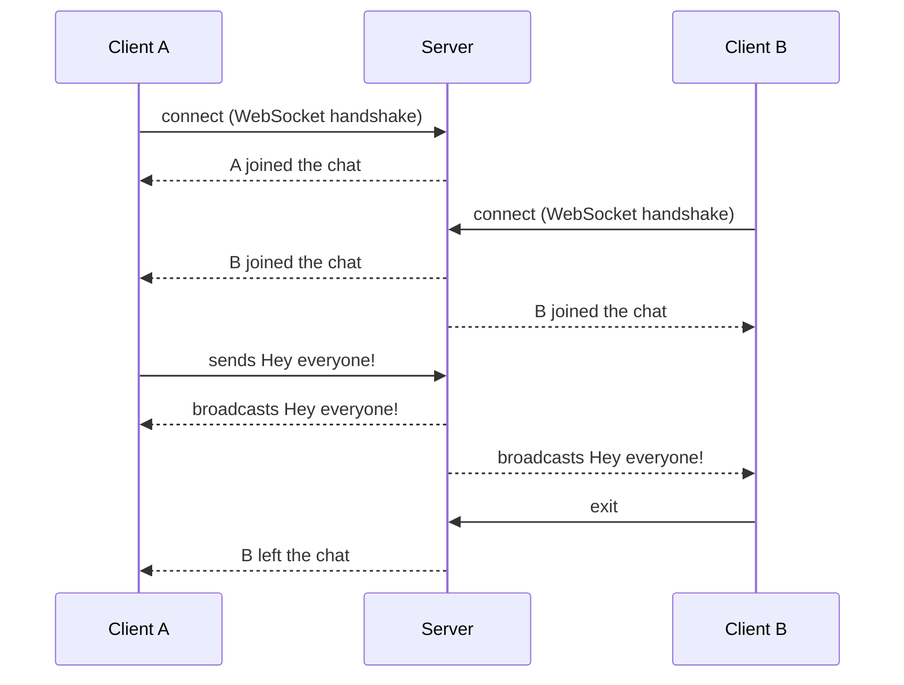

<p align="center">
  
</p>

<p align="center">
  <a href="https://roadmap.sh/projects/broadcast-server"></a>
  
  
  
</p>

<p align="center">
  A command-line chat-style broadcast server, written in Java with real WebSockets.<br>
  Start it as a server, connect from as many terminals as you like, and every message any client sends is broadcast to everyone connected.
</p>

<p align="center"><b>Project URL:</b> <a href="https://roadmap.sh/projects/broadcast-server">https://roadmap.sh/projects/broadcast-server</a></p>

<p align="center"></p>

## 🎬 See it in action

<p align="center">
  
</p>

<details>
<summary>Prefer plain text? Here is the same session.</summary>

**Terminal 1, server:**

```
$ broadcast-server start
Server started on port 8887
New client connected: /127.0.0.1:53134
New client connected: /127.0.0.1:53335
Message from /127.0.0.1:53134: Hey everyone!
Client disconnected: /127.0.0.1:53335
```

**Terminal 2, client A:**

```
$ broadcast-server connect
Connected to server!
/127.0.0.1:53134 joined the chat.
/127.0.0.1:53335 joined the chat.
Hey everyone!
/127.0.0.1:53134: Hey everyone!
/127.0.0.1:53335 left the chat.
```

**Terminal 3, client B:**

```
$ broadcast-server connect
Connected to server!
/127.0.0.1:53335 joined the chat.
/127.0.0.1:53134: Hey everyone!
exit
Disconnected from server.
Disconnected.
```

Client A's message reaches both A (its own send) and B, in real time, with no polling involved.

</details>

<p align="center"></p>

## 🚀 Getting started

### Prerequisites

- JDK 11 or later
- Gradle

### Build

```bash
gradle build
```

### Run the server

```bash
gradle run --args="start"
```

### Run a client

In a separate terminal:

```bash
gradle run --args="connect"
```

Open as many additional terminals as you like and repeat the `connect` command to add more clients.

> **About the command name.** The demo above writes the commands as `broadcast-server start` and `broadcast-server connect`. With Gradle that is `gradle run --args="start"` and `gradle run --args="connect"`. After `gradle installDist` it is the generated script `build/install/broadcast-server/bin/broadcast-server` (with a `.bat` extension on Windows).

> **Note on `Ctrl+C` with `gradle run`.** On Windows, `gradle run` wraps the Java process in a batch script, so `Ctrl+C` is intercepted by that script rather than reaching the app's shutdown hook. For a clean graceful-shutdown test, build a standalone install instead:
>
> ```bash
> gradle installDist
> .\build\install\broadcast-server\bin\broadcast-server.bat start
> .\build\install\broadcast-server\bin\broadcast-server.bat connect
> ```
>
> Running it this way lets `Ctrl+C` reach the Java process directly.

### Leaving a chat

Type `exit` in a connected client to disconnect cleanly, or press `Ctrl+C` in the server terminal to shut the whole server down (every connected client is notified).

<p align="center"></p>

## 📖 About

This is a hands-on coding challenge focused on real-time, two-way communication, the kind HTTP alone can't easily do, because HTTP connections close after a single request/response. A WebSocket connection, by contrast, stays open, so a server can push a message to a client at any time, not just in reply to a request. This project uses that to build a simple broadcast/chat server: any client that's connected gets every message any other client sends, as it happens.

**Challenge checklist**

| Requirement | Status |
|---|---|
| One CLI app with `start` (run the server) and `connect` (run a client) | ✅ |
| The server listens for connections on a port (hardcoded to `8887`) | ✅ |
| A message from one client is broadcast to every connected client | ✅ |
| Client connects and disconnects are handled gracefully | ✅ |
| Multiple clients can be connected and messaging at once | ✅ |
| Errors are handled and the server shuts down gracefully | ✅ |

This README documents how this implementation approaches each of those requirements, and what actually happens when you run it.

## ✨ Features

| Command | Mode | Description |
|---|---|---|
| `start` | Server | Starts listening for client connections on port `8887` |
| `connect` | Client | Connects to the running server and opens a chat session |

- 💬 **Real WebSocket protocol.** Not a custom text protocol, so any standard WebSocket client (even a browser) can connect and chat
- 📢 **True broadcast.** Any message a client sends reaches every connected client, via the library's built-in `broadcast()`
- 👋 **Join/leave notifications.** Every client is told when someone connects or disconnects
- 🔌 **Multiple simultaneous clients,** each in their own terminal session
- 🛑 **Graceful server shutdown.** `Ctrl+C` cleanly closes every client connection instead of just killing the process
- 🚪 **`exit` command on the client.** Leave the chat cleanly without force-killing the terminal
- ⚠️ **Error handling throughout.** A client trying to connect to a server that isn't running gets a clear message instead of a crash

<p align="center"></p>

## 🔁 How it works

<p align="center">
  
</p>

1. Run `start` in one terminal. The server begins listening on port `8887`.
2. Run `connect` in another terminal. A WebSocket connection opens to the server, and everyone connected is notified that someone joined.
3. Type a message and hit Enter. It's sent to the server, which immediately broadcasts it to every connected client (including the sender).
4. Open more terminals and `connect` again. Each one is a fully independent client, and messages from any one reach all the others in real time.
5. Type `exit` in a client to leave the chat cleanly, or press `Ctrl+C` in the server terminal to shut it down. Either way, connected clients are notified rather than just losing the connection unexpectedly.

<details>
<summary>See the same flow as a sequence diagram</summary>



</details>

## 🛠 Tech stack

- **Java 11+**
- **Gradle**, as the build tool and dependency manager
- [**Java-WebSocket**](https://github.com/TooTallNate/Java-WebSocket) provides `WebSocketServer` and `WebSocketClient`, handling the WebSocket handshake and framing so the app logic can focus on `onOpen` / `onMessage` / `onClose` / `onError`
- **slf4j-simple**, a minimal logging backend, just to keep the library quiet on startup

## 📁 Project structure

```
.
├── build.gradle           # Dependencies, plugins, and build configuration
├── settings.gradle        # Project name
├── assets/                # Animated SVGs used by this README
│   ├── banner.svg
│   ├── flow.svg
│   ├── terminal-demo.svg
│   └── divider.svg
└── src/
    └── main/
        └── java/
            └── app/
                ├── App.java      # CLI entry point, dispatches to start/connect
                ├── Server.java   # extends WebSocketServer: connection + broadcast logic
                └── Client.java   # extends WebSocketClient: send/receive + the chat loop
```

<p align="center"></p>

## ⚠️ Known limitation

<details>
<summary>A small rough edge when the server stops while a client is idle</summary>

If the server is stopped while a client is still connected, that client correctly detects the disconnect (`Disconnected from server.`). However, if the client is left idle and more text is typed into it afterward, it still tries to send that message before noticing the connection is gone, producing a `Could not send message` line rather than exiting immediately. It does exit cleanly on the next input after that.

This doesn't affect the core broadcast functionality. It's a minor rough edge in an already-rare scenario (typing into a client after its server has already gone down) rather than something that comes up in normal use.

</details>

## 🧠 What I learned

<details open>
<summary>Building this project helped me understand:</summary>

- Why WebSockets exist: the difference between HTTP's one-shot request/response model and a persistent, two-way connection
- Extending an abstract class to plug application logic into a library's event lifecycle (`onOpen`, `onMessage`, `onClose`, `onError`, `onStart`) rather than writing a request loop by hand
- That a WebSocket library runs its networking on its own background thread, so a client can receive messages at any moment, even mid-`Scanner.nextLine()`, without the app explicitly managing threads itself
- The difference between a non-blocking call (`start()`) and a blocking one (`connectBlocking()`), and why that distinction matters for program flow
- Thread-safe state sharing between threads using `volatile`, after running into a stale-read problem where one thread's connection-closed update wasn't being seen by another thread's loop
- Implementing a graceful shutdown with `Runtime.getRuntime().addShutdownHook(...)`, and that `Ctrl+C` doesn't always reach a Java process directly: on Windows, `gradle run`'s batch wrapper intercepts it, which `gradle installDist` sidesteps
- Testing a multi-client, real-time system by hand, using several terminals at once, rather than a single linear request/response flow

</details>

<p align="center"></p>

<p align="center">
  Project reference: <a href="https://roadmap.sh/projects/broadcast-server">https://roadmap.sh/projects/broadcast-server</a>
</p>